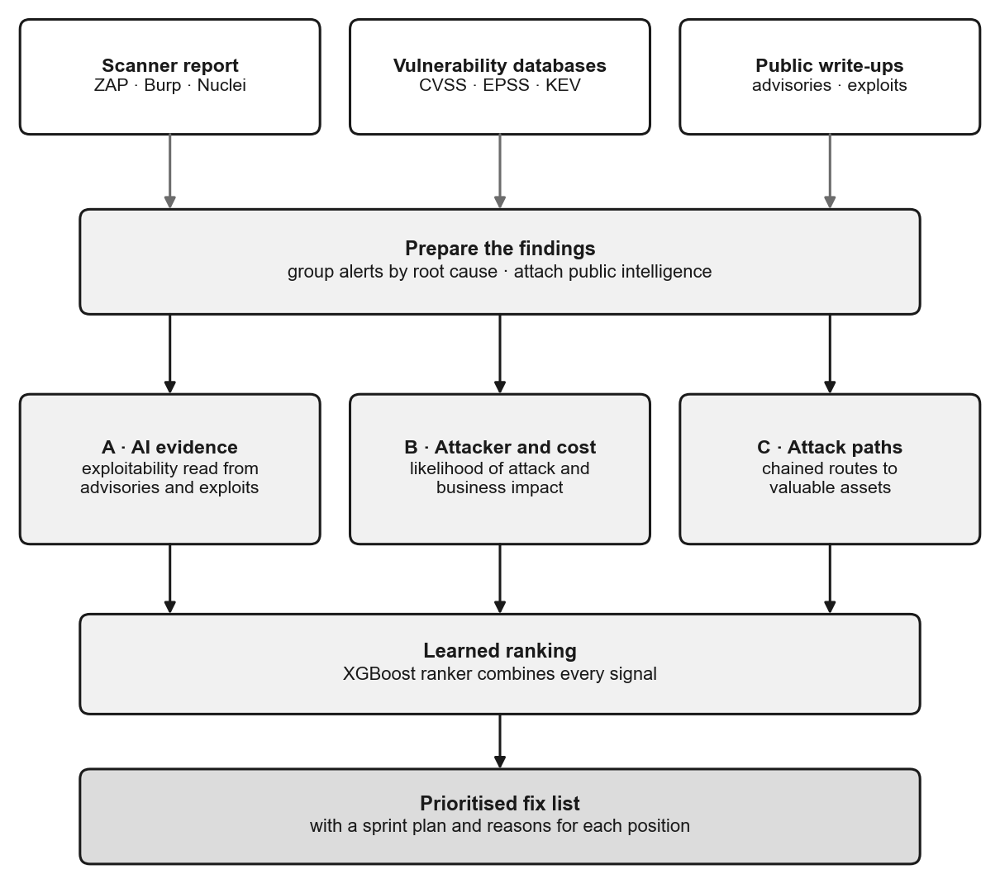
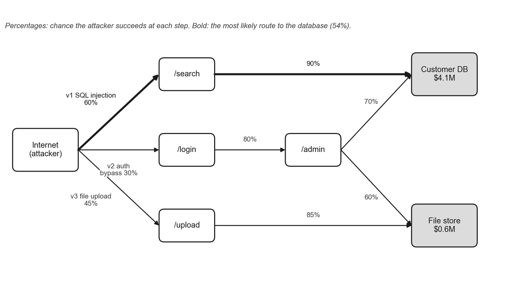
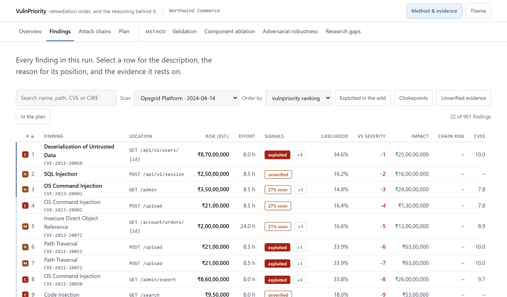
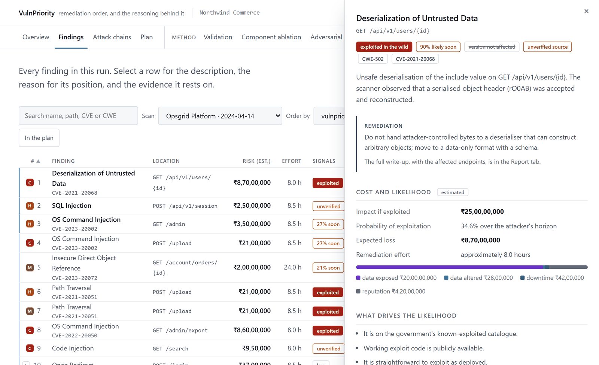
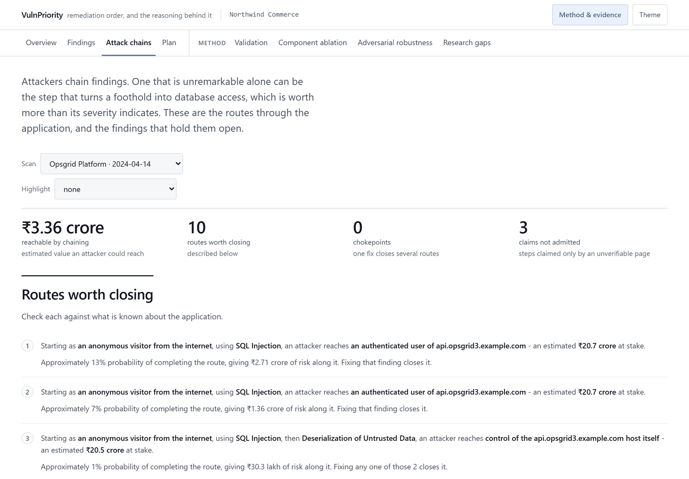
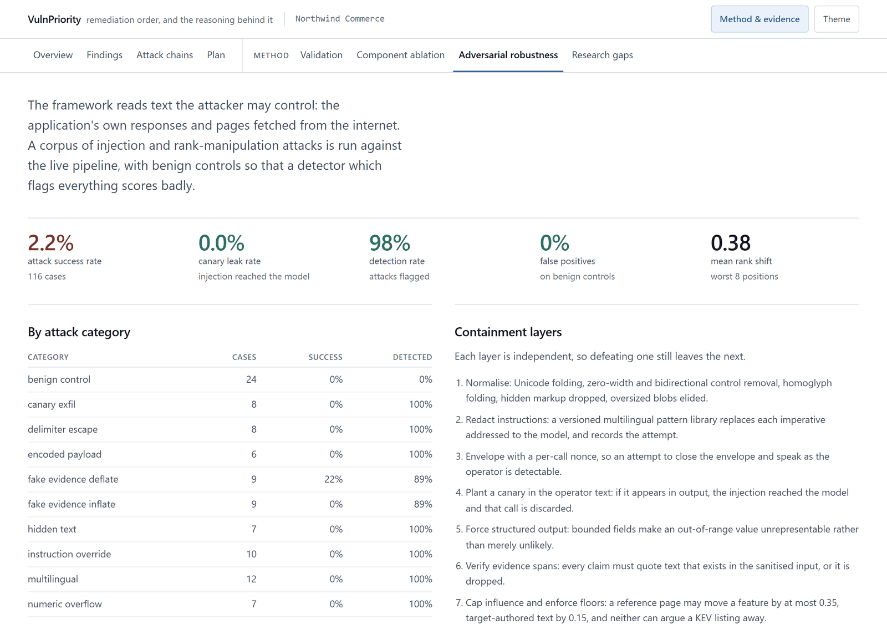
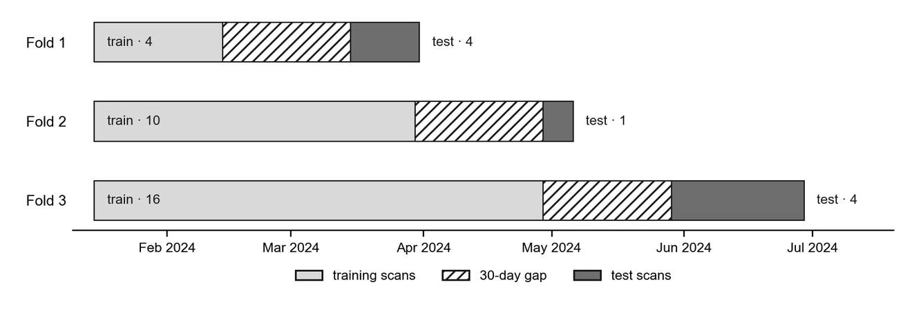
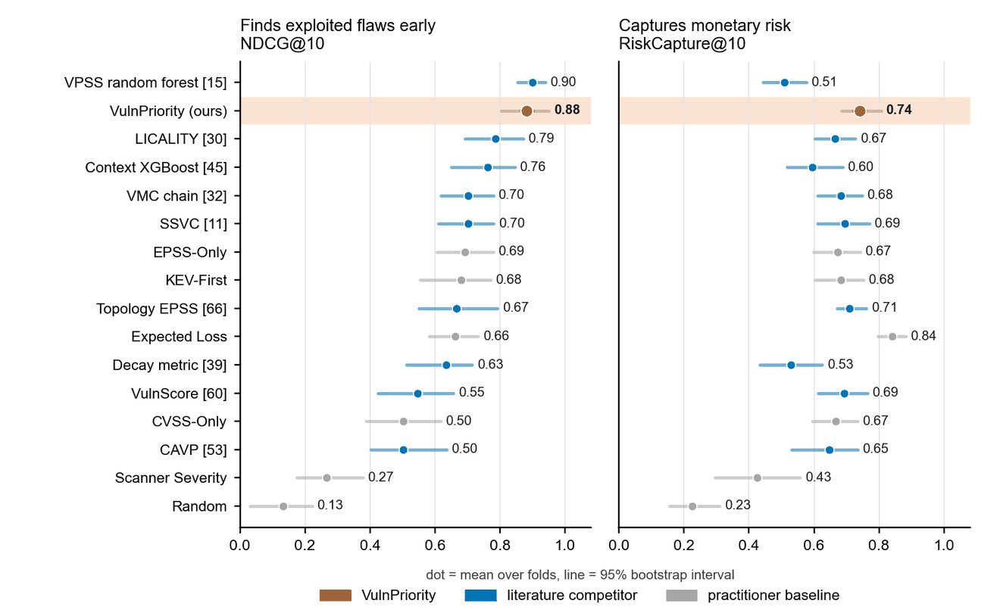
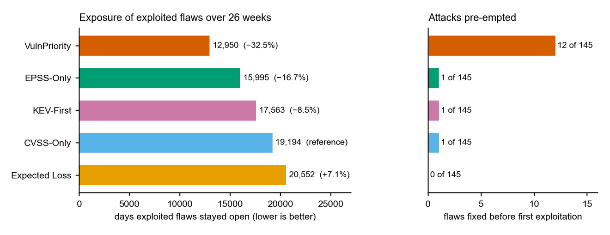

# VulnPriority

**AI-driven automated web application vulnerability prioritization.**

A single web application scan returns hundreds of findings. Sorting them by CVSS does not tell
you which ones an attacker will actually use: published severity correlates with real-world
weaponisation at about rho = 0.1, and three quarters of all CVEs cluster into ten distinct
scores. This framework orders a scan's findings by **expected loss** instead, combining what
the scanner saw, what public vulnerability intelligence says, what the referenced advisories
and exploit reports mean, and where the finding sits on the path to something worth stealing.

It is the implementation of the framework proposed in the accompanying literature review, and
it is built so that every claim in that review's gap analysis is answered by a module and a
test rather than by prose.

---

## What it does

<p align="center">
  
</p>

```
scanner output ─► ingest ─► intelligence ─┬─► A  semantic assessment   (sandboxed model)
                                          ├─► B  attacker model + monetary impact
                                          ├─► C  attack graph contribution
                                          └─► features ─► LambdaMART ─► explained ranking
                                                              │
                                          evaluation ◄────────┴───────► selection, simulation,
                                          (splits, labels, metrics,      adversarial robustness
                                           ablation, calibration)
```

**Priority is defined, not asserted.** `expected_loss = P(exploit | evidence, attacker) × impact`,
in the configured currency, with every term in the probability recorded for audit.

**The attacker is explicit.** Five presets ship (opportunistic, targeted criminal, insider,
advanced persistent, content-controlling). Changing the attacker re-prioritises the queue
without retraining, because the adversary is a parameter rather than an assumption.

**The model extracts features; it does not decide.** Advisories and application responses are
read inside a sandbox and turned into bounded, schema-validated assessments. A gradient-boosted
ranker learns the ordering from confirmed-exploitation labels.

**Attacker-controlled text is contained.** Evidence carries a trust tier, and a tier's
influence on any feature is capped. A reference page can move a normalised feature by at most
0.35; text authored by the target itself by at most 0.15; neither can argue away a KEV listing.
Robustness is measured against a corpus of injection attacks, in the test suite.

**Chains are first class.** Findings are scored by how much reachable compromise they enable,
over a directed multi-hop attack graph, so a low-severity chokepoint outranks a high-severity
leaf. Patching can never increase computed risk, and a property test proves it.

<p align="center">
  
  <br><sub>A worked example: percentages are the attacker's chance of succeeding at each step, and
  the bold route is the most likely path to the customer database.</sub>
</p>

**It runs offline.** The default configuration needs no API key and no network. A synthetic
world with a latent exploitation oracle supplies the confirmed ground truth and the
counterfactual remediation outcomes that no public dataset provides.

---

## Install

Python 3.12 or newer.

```bash
python -m pip install -e .
```

Optional extras: `pip install -e ".[gemini]"` for the free-tier backend, `".[llm]"` for
Anthropic, `".[web]"` for the interactive site, `".[dev]"` for pytest.

Every command below also works as `python -m vulnpriority ...`. On Windows the console script
lands in Python's user scripts directory, which is often not on `PATH`, so `vulnpriority serve`
can fail with "not recognized as a name of a cmdlet" even though the install succeeded. The
module form needs nothing but the interpreter that already imported the package.

## Quick start

Generate a synthetic world, run the whole pipeline on it, and write the report:

```bash
vulnpriority run-all --config configs/default.yaml --synthetic
```

Rank a real OWASP ZAP report:

```bash
vulnpriority ingest --input scan.json --scanner zap --output runs/myapp
vulnpriority run-all --config configs/default.yaml --scan runs/myapp/scan.json
```

Use live feeds and the Anthropic backend:

```bash
export ANTHROPIC_API_KEY=...        # Windows: setx ANTHROPIC_API_KEY ...
vulnpriority run-all --config configs/live.yaml --scan runs/myapp/scan.json
```

Re-prioritise the same scan for a different adversary:

```bash
vulnpriority rank --config configs/default.yaml --attacker insider
```

## The results website

The framework ships with a website that presents a run: the remediation queue with the
reasoning behind each position, the attack graph and its highest-value paths, the evaluation
against baselines, the component ablation, budget and exposure outcomes, the adversarial
robustness measurements, and a live traceability table tying each research gap to the numbers
this run produced. The screenshots below are from a run on the synthetic world; monetary
figures are model estimates in the configured currency.

<p align="center">
  
  <br><sub><b>Findings.</b> One scan's findings in remediation order, with estimated risk,
  effort, exploitation signals and CVSS side by side.</sub>
</p>

<p align="center">
  
  <br><sub><b>Why a finding is where it is.</b> Selecting a row opens its impact breakdown,
  probability of exploitation, expected loss and the reasons for its position.</sub>
</p>

<p align="center">
  
  <br><sub><b>Attack chains.</b> The routes through the application, in plain sentences, and the
  finding that holds each one open.</sub>
</p>

<p align="center">
  
  <br><sub><b>Adversarial robustness.</b> The injection corpus results by attack category,
  next to the containment layers each attack has to get through.</sub>
</p>

It runs in two modes.

**As an application.** Start the server, open it, and give it either a scanner report to
upload or a target to assess. It runs the pipeline and shows the prioritized queue, the attack
chains, the generated report and the novelty analysis.

```bash
pip install -e ".[web]"
vulnpriority serve
```

Assessing a target requires an explicit authorization attestation: you state that you are
authorized to test it, and that statement is recorded in the report. The scanner stays on the
host you name, rate-limits itself, refuses to follow destructive-looking links, and sends no
exploitation payloads. If OWASP ZAP, Nuclei, Wapiti or Nikto is installed, it drives those
instead of its own crawler.

`robots.txt` is read but **advisory by default**. It is a crawler convention, not an access
control: it keeps search engines out of a directory and keeps nobody else out of anything,
and an attacker reads it as a list of what the operator thought worth hiding. An authorized
assessment that honours it reports those paths as clean when it never looked at them. Every
dedicated scanner ignores it for the same reason. The paths it names are reported either
way, and `--respect-robots` restores the crawler-courtesy behaviour; `Crawl-delay` is
honoured regardless, because that one is a statement about what the server can take.

**Single-page applications are visible to it.** An application whose HTML is one mount
element and three bundles gives a link-following crawler nothing to follow, so a naive
crawl ends after the shell and reports a short queue - which reads as a clean application
rather than as a scan that never started. Instead, the request paths the client code names
in its own JavaScript are recovered and crawled, subject to every existing control; routes
that come back as the shell are recognised and not counted twice. On OWASP Juice Shop that
is the difference between 6 endpoints and 90.

**What the scan could not see is stated, not implied.** Every assessment ends with coverage
notes: that the target was a single-page application, how many mined paths a budget cut
short, which paths `robots.txt` disallowed and therefore went unassessed. A short list of
findings is ambiguous on its own, and these sentences are what disambiguate it.

**As a static page.** Export a finished run to a self-contained page: one HTML file, one
stylesheet, one script and one data document. It opens from disk with no server and no
network, which matters because offline reproducibility is the framework's own claim.

```bash
vulnpriority web --run runs/<run_id> --output site
python -m vulnpriority.web --demo --serve      # see the page before running anything
```

## Commands

| Command | What it does |
|---|---|
| `synth` | Generate the synthetic world: scans, feed fixtures, reference pages, exploitation oracle |
| `ingest` | Parse ZAP, Burp, Nuclei or canonical JSON into a `Scan`, template paths, correlate root causes |
| `fetch-feeds` | Populate the feed cache for an as-of date |
| `assess` | Component A: asset criticality, exploitability, applicability |
| `enrich` | Component B: attacker likelihood, monetary impact, remediation cost, expected loss |
| `chain` | Component C: build the attack graph and score each finding's reachability contribution |
| `rank` | Build features, run the ranker, produce the explained remediation queue |
| `train-ranker` | Fit the LambdaMART ranker on a labelled corpus and save it, so single-scan runs score with a learned model rather than falling back |
| `explain` | Show the factors behind one finding's position |
| `evaluate` | Time-ordered evaluation against confirmed-exploitation labels, with baselines |
| `ablate` | Full 2³ factorial ablation over components A, B and C |
| `select` | Knapsack selection under a remediation budget |
| `simulate` | Longitudinal exposure simulation per policy |
| `adversarial` | Run the prompt-injection and rank-manipulation corpus |
| `report` | Write `report.md`, `report.json` and figures |
| `run-all` | The whole chain, one command |
| `scan` | Assess an authorized target directly, with no scanner report |
| `serve` | Run the interactive site: upload a report or assess a target |
| `web` | Export the static results website from a finished run |
| `novelty` | Compare this framework's capabilities against the reviewed prior work |
| `manifest` | Print the run manifest: config hash, seeds, dataset hash, library versions |

## Configuration

`configs/default.yaml` is offline and deterministic. `configs/live.yaml` uses live feeds and
the Anthropic backend. Attacker presets live in `configs/attacker_models/`, impact models in
`configs/impact_models/`, and the injection pattern library in `configs/sandbox/`.

Any field can be overridden on the command line, for example `--set ranking.n_estimators=500`.

## Evaluation

The protocol is fixed in advance and recorded in the run manifest, because the review's
clearest finding is that published results are not comparable to each other.

| Element | Choice |
|---|---|
| Splits | Time-ordered with a 30-day gap; leave-one-application-out for transfer; random only as a control |
| Labels | KEV, exploit evidence, incidents, synthetic oracle. Never CVSS |
| Label protocol | Strict by default: a positive backed only by KEV or exploit-feed evidence, which the ranker also reads as features, earns no credit. `--set evaluation.exclude_circular_labels=false` counts every confirmed-exploitation label |
| Ranking | NDCG@{5,10,20}, Precision@K, RiskCapture@K, MAP, MRR, mean rank of exploited |
| Classification | ROC-AUC, PR-AUC, MCC, minority-class F1, balanced accuracy |
| Calibration | Brier, expected calibration error, reliability bins |
| Decision | Efficiency, coverage, workload reduction, risk capture under budget |
| Longitudinal | 26-week exposure-day simulation per policy |
| Practitioner baselines | CVSS-only, EPSS-only, KEV-first, scanner severity, expected loss, random |
| Literature competitors | VMC chain (Shimizu & Hashimoto), CISA SSVC, CAVP temporal CVSS, the Albanese et al. decay metric, VulnScore, context-aware XGBoost (Sevimli Deniz & Koca), the VPSS random forest (Hore et al.), LICALITY, EPSS-weighted attack-graph importance (Tiță et al.) |
| Ablation | Full factorial over A, B, C with main effects, interactions and paired bootstrap intervals |

<p align="center">
  
  <br><sub>Time-ordered folds on the synthetic world: train on earlier scans, skip 30 days, test
  on later ones.</sub>
</p>

### Comparing against the literature

The literature competitors live in `src/vulnpriority/rank/literature.py`. None of the original
systems is published in a form that consumes web-scanner output, so each is re-implemented from
its paper and handed only the inputs that paper assumes; none sees Component A's intel features,
Component B's attacker probability or Component C's monetary reachability. The learned ones are
trained on each fold exactly as LambdaMART is. To put every ranker through the same folds,
labels and metrics on a finished run:

```bash
python scripts/compare_literature.py runs/<run_id> inclusive   # every confirmed label
python scripts/compare_literature.py runs/<run_id> strict      # the default protocol above
```

Each call writes `literature_comparison_<protocol>.json` and `.md` into the run directory. On a
synthetic world of 24 scans and 901 findings it gives:

| Ranker | NDCG@10 (all labels) | RiskCapture@10 | NDCG@10 (strict) |
|---|---|---|---|
| **VulnPriority** | 0.883 | **0.741** | **0.610** |
| VPSS random forest | **0.900** | 0.508 | 0.573 |
| LICALITY | 0.785 | 0.665 | 0.361 |
| Context-aware XGBoost | 0.762 | 0.596 | 0.429 |
| VMC chain | 0.702 | 0.683 | 0.028 |
| SSVC | 0.701 | 0.695 | 0.025 |
| EPSS-only | 0.693 | 0.673 | 0.030 |
| CVSS-only | 0.503 | 0.667 | 0.087 |
| Random | 0.133 | 0.225 | 0.034 |

The VPSS random forest and VulnPriority are level on NDCG@10 when every label counts (their
95% intervals overlap almost entirely); VulnPriority captures the most monetary risk and ranks
first under the strict protocol, where every threshold method that reads KEV or EPSS falls to
the level of the random control. Like every number here, these come from a synthetic world and
validate the protocol rather than measure field performance.

<p align="center">
  
  <br><sub>All sixteen rankers on the inclusive protocol: finding exploited flaws early (left) and
  capturing monetary risk (right). Dots are fold means, lines 95% bootstrap intervals.</sub>
</p>

Over a 26-week simulation with 20 engineering hours a week, the ordering decides which
exploited flaws get fixed before they are first exploited and how long the rest stay open:

<p align="center">
  
</p>

### The shipped ranker

`src/vulnpriority/rank/models/lambdamart.ubj` is what a single real scan is ranked with, since
one scan alone has too few labelled pairs to learn from. It is trained on a 10,000-scan
synthetic corpus that is too large to commit but is fixed by its seed, so it can be rebuilt and
the model retrained:

```bash
python scripts/build_training_corpus.py --scans 10000    # writes data/synthetic-10k/ and the model
python scripts/build_training_corpus.py --scans 500 --no-save-model --out data/synthetic-smoke --report data/smoke-audit.json   # smoke run; leaves the shipped model alone
```

## Tests

```bash
python -m pytest -q
```

Everything runs offline. The suite includes property tests (patching never increases graph
risk), adversarial tests (attack success rate and canary leak rate are assertions), temporal
leakage tests, and an end-to-end run on synthetic data.

## Limitations

The exploitation oracle used for offline evaluation is synthetic. It is deliberately driven by
latent variables the framework never sees, so the evaluation is not circular, but a synthetic
world is not a real one and the absolute numbers should be read as protocol validation rather
than as field performance. Attacker and impact parameters are configured, not fitted; the
weights are defensible priors awaiting deployment data. Influence budgets are judgement calls
measured by the adversarial corpus rather than derived. Maximum-probability paths understate
risk when many independent paths reach the same target.
